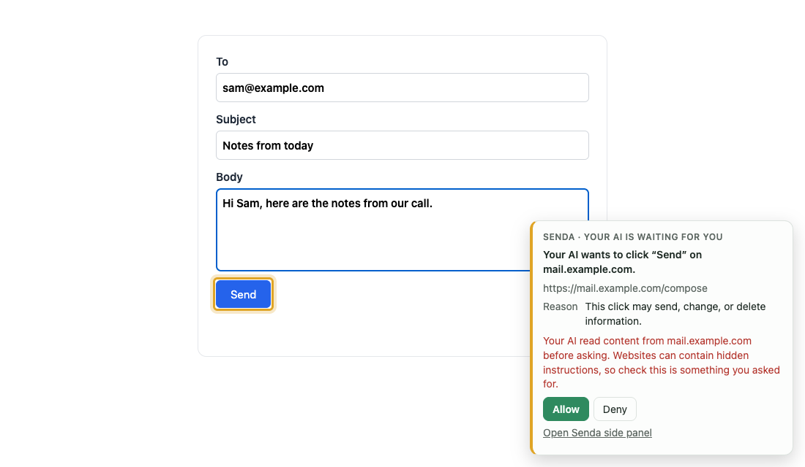
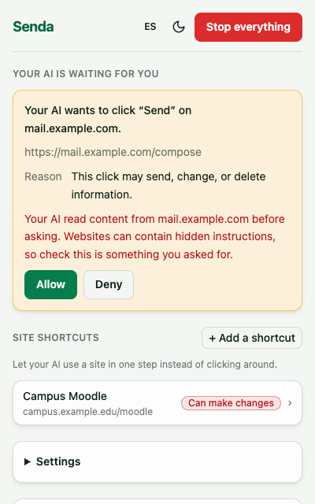
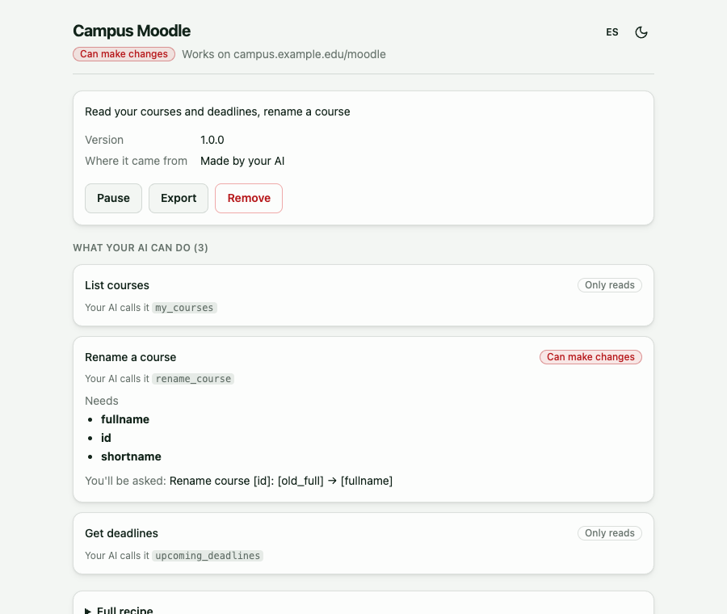

<p align="center">
  
</p>

<h1 align="center">Senda</h1>

<p align="center">
  <b>Trails for your AI through the web.</b><br>
  <a href="https://github.com/epulla/senda/actions/workflows/build.yml"></a>
</p>

Senda is a browser extension plus a local MCP server. Your AI assistant (Claude Code, Patio or any MCP client) can open pages, read them, click and type in your own browser, signed in as you. It works only in tabs it opens, inside a visible "🤖 MCP" tab group, and by default stops to ask you on the page before actions that look like sending, changing or deleting something.

<p align="center">
  <a href="https://github.com/epulla/senda/releases/latest"></a><br>
  <sub>Chrome, Brave or Edge · <a href="#quick-start">install steps</a> · <a href="https://github.com/epulla/senda/releases">all releases</a></sub>
</p>

<p align="center">
  
</p>

> **Status:** early release. It works and is tested end to end, but expect rough edges and breaking changes. Not yet in the Chrome Web Store; you load it unpacked.

<p align="center"></p>

## Why Senda

Many browser MCP servers drive a separate, automated browser. Senda takes a different path:

- **Your real browser, your logins.** No new profile, no copied cookies. The AI uses the sites you are already signed into.
- **Only its own tabs.** The AI works in a "🤖 MCP" tab group you can see. Your other tabs stay out of reach.
- **Site shortcuts (adapters).** Your AI can write a small recipe for a site (for example "list my courses") so next time it is one tool call instead of dozens of clicks. Recipes are plain JSON, never code, and nothing is installed until you approve it in the side panel.
- **Approvals on the page.** Clicks that look like sending, paying or deleting (judged by the button's label), form submits and sharing data with a new site pause with a card on the page, with the target highlighted. How much to ask is up to you (side panel → Ask me before). New or changed shortcuts are approved in the side panel. Only real clicks count, so a page script cannot approve for you.
- **Prompt-injection defenses.** Page content is marked as untrusted data for the AI. Suspected injection is flagged ⚠️ and logged, and pages that try it trigger extra approvals.
- **Private fields stay private.** Password, card and one-time-code fields are blurred in screenshots.
- **One button to stop.** "Stop everything" in the side panel disconnects the AI, closes its tabs and pauses every shortcut.

<p align="center">
  
  
</p>

## Quick start

Needs [Node.js](https://nodejs.org) 20+ and a Chromium browser (Chrome, Brave or Edge).

1. **Download** from the [latest release](https://github.com/epulla/senda/releases/latest):
   - `senda-extension-<version>-chrome.zip`: the browser extension. Unzip it into a folder you will keep.
   - [`senda-mcp.js`](https://github.com/epulla/senda/releases/latest/download/senda-mcp.js): the MCP server, a single file. Save it somewhere you will keep, for example `~/.senda/senda-mcp.js`.

2. **Load the extension.** Open `chrome://extensions` (or `brave://extensions`, `edge://extensions`), turn on Developer mode, click **Load unpacked** and pick the unzipped folder.

3. **Add the MCP server to your AI client.** Use the absolute path to `senda-mcp.js`.

   Claude Code:

   ```sh
   claude mcp add senda -- node /path/to/senda-mcp.js
   ```

   Any MCP client that takes a JSON config:

   ```json
   {
     "mcpServers": {
       "senda": {
         "command": "node",
         "args": ["/path/to/senda-mcp.js"]
       }
     }
   }
   ```

   Patio: add an MCP server with the same command and arguments.

4. **Pair.** Print the pairing code and paste it into the Senda setup page that opened when you loaded the extension:

   ```sh
   node /path/to/senda-mcp.js token
   ```

5. **Try it.** The Senda icon shows a green "on" badge when connected. Ask your AI: "Open example.com and tell me the title."

### Build from source

Needs [pnpm](https://pnpm.io) as well.

```sh
git clone https://github.com/epulla/senda.git
cd senda
pnpm install
pnpm build
```

Then follow the steps above with `packages/extension/.output/chrome-mv3` as the extension folder and `packages/server/dist/index.js` as the server file.

The server listens on `127.0.0.1:18765` (set `SENDA_PORT` to change it) and keeps its token in `~/.senda/token`.

## Tools

| Tool | What it does |
| --- | --- |
| `browser_list` | List connected browsers by name and id. |
| `browser_navigate` | Open a URL. |
| `browser_snapshot` | Read the page (or one element) as text with element refs. |
| `browser_click` / `browser_type` | Click an element or type into a field by ref. |
| `browser_scroll` | Scroll the page. |
| `browser_screenshot` | Capture the page or one element as an image, private fields blurred. |
| `browser_back` / `browser_forward` | Move through the tab's history. |
| `browser_tabs` | List, open, select or close tabs. |
| `adapter_schema` | Show the recipe format and authoring notes. |
| `adapter_draft` / `adapter_test` / `adapter_submit` | Write a shortcut, test it, send it to you for approval. |
| `adapter_install` | Install a shared recipe (JSON or HTTPS URL) as a draft for approval. |
| `adapter_list` / `adapter_disable` / `adapter_remove` | Manage installed shortcuts and drafts. |
| `adapter_call` | Run a tool from an installed shortcut. |

Each approved shortcut tool also shows up as its own tool, named `<adapter>__<tool>`. Set `SENDA_ADAPTER_TOOLS=compact` to skip those and use `adapter_call` only.

## Security and privacy

- Senda pauses protected actions for approval with a card on the page your AI is using; the side panel shows the same requests. Only real clicks count, so a page script cannot approve for you.
- Suspected prompt injection is marked ⚠️ and logged; pages can taint a site and trigger extra approval.
- "Never ask" (side panel → Ask me before) skips on-page approvals until Senda suspects prompt injection on a page your AI read. New or changed shortcuts still need your approval. It is not recommended and shows a red badge while on.
- Pages, emails and chats your AI reads (including other people's messages) are sent to your AI provider by your AI client.
- Other MCP servers connected to your AI client (such as Slack or email) are outside Senda's protection. Keep client approvals on for tools that send things.
- The extension talks only to the local server on `127.0.0.1`, except when you or your AI import a shortcut recipe from an HTTPS URL: then it fetches that URL. Details, storage and permissions: [PRIVACY.md](packages/extension/PRIVACY.md).

## Development

```sh
pnpm install
pnpm compile
pnpm test
pnpm build
```

`pnpm test` runs the unit tests. `pnpm e2e` builds the extension and server, then drives them end to end with Playwright: its own Chromium loads the extension, a temporary Senda server and the fixture site run on free ports, and the side panel opens as a normal page. Your real `~/.senda` token and running servers are untouched. First time only: `pnpm --filter @senda/extension exec playwright install chromium`.

`pnpm --filter @senda/extension dev` runs the extension with live reload. Release files: `pnpm build && pnpm --filter @senda/extension zip` makes `packages/extension/.output/senda-extension-<version>-chrome.zip`; `packages/server/dist/index.js` ships as `senda-mcp.js`. To regenerate the screenshots above: `SENDA_SHOTS=1 pnpm e2e readme-shots`.

Layout:

- `packages/extension`: the browser extension (WXT, React).
- `packages/server`: the local MCP server.
- `packages/protocol`: messages shared by both.
- `packages/adapter-schema`: the site shortcut recipe format.

## Contributing

Issues and pull requests are welcome. Before opening a PR, run `pnpm compile && pnpm test` (and `pnpm e2e` if you touched the extension), and use [Conventional Commits](https://www.conventionalcommits.org) (`fix(runner): ...`). [AGENTS.md](AGENTS.md) lists the project rules, such as keeping all browser calls out of `src/core` and every UI string in the English and Spanish text files.

## License

[MIT](LICENSE)
